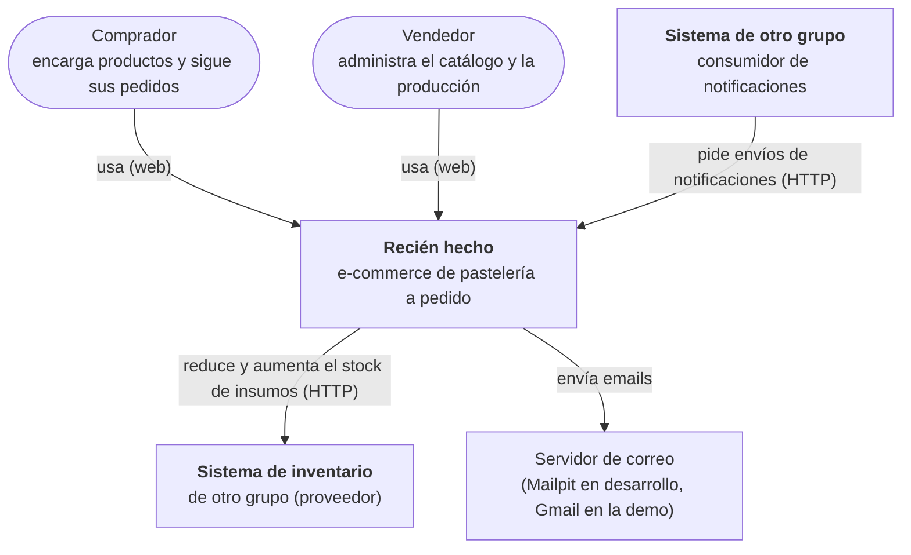
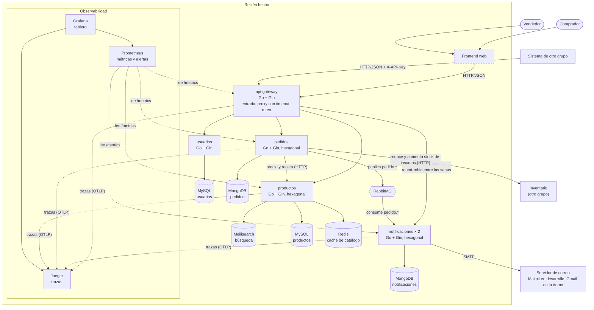
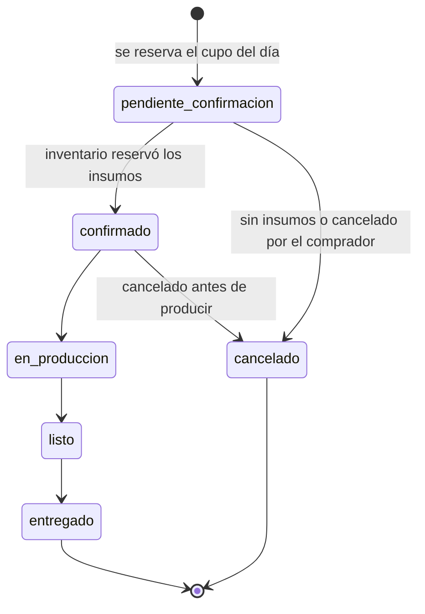

# Arquitectura

Versión de la Entrega 2, actualizada al 29/10/2026 con todos los servicios, el frontend, el balanceo y los tests de carga. Las decisiones que la sostienen están en [docs/adr/](adr/).

## Visión general

Recién hecho es un e-commerce de pastelería a pedido. Los compradores encargan productos para ahora, para una fecha futura o a medida, y la pastelería organiza su producción según la capacidad que tiene cada día.

El backend son cuatro microservicios en Go (Gin) detrás de un api gateway, orquestados con Docker Compose. El sistema publica una capacidad para otro grupo (**notificaciones**) y consume la de otro grupo (**inventario**).

### Diagrama de contexto

### Diagrama de contenedores

Los componentes con borde continuo ya están en el `docker-compose`. Los de borde punteado están decididos en los ADRs y se suman para la presentación ([ADR-002](adr/ADR-002-persistencia.md)).
Desde afuera solo se entra por el api-gateway (`localhost:8080`). Los servicios no publican puerto, y las herramientas de desarrollo (MongoDB, Mailpit, Jaeger, Prometheus, Grafana) se ven solo desde la propia computadora ([ADR-006](adr/ADR-006-observabilidad.md), [ADR-012](adr/ADR-012-balanceo-de-carga.md)).

## Servicios

Cada servicio es el único dueño de sus datos ([ADR-001](adr/ADR-001-limites-de-los-servicios.md)).

| Servicio | Puerto | Responsabilidad | Datos propios | Expone |
|---|---|---|---|---|
| api-gateway | 8080 | Punto de entrada único, autenticación (verifica el JWT de `Authorization: Bearer`, [ADR-016](adr/ADR-016-autenticacion.md)), ruteo, límite de uso de notificaciones por grupo ([ADR-004](adr/ADR-004-contrato-de-notificaciones.md)) | Ninguno | Todas las rutas públicas |
| usuarios | 8081 | Registro, login, roles comprador/vendedor | Cuentas, roles, contraseñas hasheadas | Registro, login, perfil |
| productos | 8082 | Catálogo, búsqueda, recetario | Productos, precios (centavos), imágenes, recetas | Catálogo, búsqueda, ABM (vendedor) |
| pedidos | 8083 | Pedidos inmediatos, programados y especiales; calendario y capacidad de producción | Pedidos y estados, cupos por día | Crear y seguir pedidos, calendario (vendedor) |
| notificaciones | 8084 | Envío de avisos a compradores y a usuarios de otros grupos | Notificaciones, estados, claves de idempotencia | [Contrato](contracts/notificaciones/notificaciones.yaml) |

La capacidad de producción vive en `pedidos` porque reservar el cupo y crear el pedido tienen que ser una sola operación atómica: es la operación del sistema que no puede duplicar ni perder información.

Cada servicio vive en `backend/<servicio>/`, con su propio `go.mod` y `Dockerfile`, y ningún servicio importa código de otro. `notificaciones`, `pedidos` y `productos` son hexagonales (dominio, aplicación, puertos y adaptadores) `usuarios` está en capas (handler, servicio y repositorio) y el api-gateway es un proxy sin dominio; la arquitectura interna de cada uno está en [ADR-007](adr/ADR-007-arquitectura-interna.md). El puerto de la tabla es el interno: desde afuera solo se entra por el api-gateway, salvo `GET /internos/productos/{id}`, que `pedidos` llama dentro del compose y el gateway no enruta ([ADR-003](adr/ADR-003-comunicacion-entre-servicios.md)).

### Estados de un pedido

Los pedidos especiales pasan antes por `solicitado` → `cotizado` y de ahí a `aceptado` (sigue como `pendiente_confirmacion`), `rechazado` o `vencido` (48 h sin respuesta del comprador).

## Datos

| Servicio | Almacenamiento | Motivo |
|---|---|---|
| usuarios | MySQL | Datos tabulares, email único |
| productos | MySQL + Redis | Filtros sobre el catálogo; se lee mucho y cambia poco |
| pedidos | MongoDB | Pedido como documento con sus ítems; campos libres en pedidos especiales |
| notificaciones | MongoDB | Documentos simples, clave de idempotencia única por grupo |

Montos siempre en centavos (`int64`). Detalle y limitaciones en [ADR-002](adr/ADR-002-persistencia.md).

## Comunicación entre servicios

- **Síncrona (HTTP/JSON):** frontend y otros grupos → api-gateway → servicios; `pedidos` → `productos` (precio y receta); `pedidos` → inventario del otro grupo. Con timeouts y reintentos solo en operaciones idempotentes.
- **Asíncrona (RabbitMQ):** `pedidos` publica `pedido.estado_cambiado` cada vez que un pedido se crea o cambia de estado; `notificaciones` lo consume y avisa al comprador.

Valores y reglas en [ADR-003](adr/ADR-003-comunicacion-entre-servicios.md).

## Mensajería y eventos

Exchange `pedidos` (topic), cola quorum `notificaciones.pedidos` con hasta 3 reentregas y DLQ `notificaciones.fallidos`. El consumidor es idempotente por `idEvento`, que usa como `Idempotency-Key` de la notificación. `pedidos` no publica directo: guarda el evento en su bandeja de salida (outbox) en la misma transacción que el cambio, y un proceso lo publica con confirmación del broker ([ADR-015](adr/ADR-015-consistencia-y-concurrencia.md)). La web de RabbitMQ (http://localhost:15672) muestra las colas.

## Observabilidad

Decisiones en [ADR-006](adr/ADR-006-observabilidad.md) (D11).

- **Logs:** api-gateway y notificaciones escriben una línea JSON por evento en la salida estándar (`docker compose logs`), con `servicio` y, cuando hay una traza activa, `trace_id` y `span_id`. Cada solicitud HTTP deja una línea con `metodo`, `ruta`, `estado` y `duracion_ms`, y cada envío fallido de una notificación, una con `id`, `intento`, `resultado` y `error` (con los emails tapados). No se registran claves de API, claves de idempotencia, destinatarios ni contenidos de mails.
- **Trazas:** OpenTelemetry en api-gateway, pedidos, productos y notificaciones, exportadas por OTLP a Jaeger (http://localhost:16686). Una solicitud a `POST /notificaciones` por el gateway queda como una sola traza: api-gateway → reenvío HTTP → notificaciones → comandos de MongoDB. Los logs de esa solicitud llevan el mismo `trace_id`. Un `POST /pedidos` también queda como una sola traza, que sigue por RabbitMQ (el `traceparent` viaja en los headers del mensaje) hasta el consumidor de notificaciones. Si Jaeger está caído, los servicios siguen funcionando y solo se pierden las trazas.
- **Métricas:** cada servicio publica `/metrics` en un puerto interno (9464) que no sale del compose; Prometheus lo lee cada 15 s. Las dos tienen `solicitudes_http_total` por método, ruta y estado, y `duracion_solicitud_http_segundos` por método y ruta. El gateway suma `gateway_solicitudes_total` por instancia (reparto del balanceo, ADR-012), `gateway_instancia_sana` (1 si la instancia está en el balanceo, 0 si quedó afuera) y notificaciones suma `notificaciones_envios_total` por resultado (`enviada`, `reintento`, `fallida`), que la aplicación avisa por el puerto `Eventos`: el adaptador `eventos` decide qué contar y qué loguear, así la aplicación no depende de Prometheus ni de `slog`. Productos suma `cache_aciertos_total` y `cache_fallos_total` por tipo (la tasa de aciertos de [ADR-009](adr/ADR-009-cache.md)) e `indice_pendiente_antiguedad_segundos`, el retraso de la búsqueda (RNF1).
- **Alertas** (`observabilidad/prometheus/alertas.yml`): `NotificacionesFallidas` (más de 5 en 10 minutos), `InventarioRechazaReservas`, `CircuitoDelInventarioAbierto`, `ObjetivoDeLatenciaIncumplido` (menos del 99 % de los `POST /notificaciones` en menos de 300 ms en la última hora), `BusquedaAtrasada` (un cambio de producto lleva más de 10 s sin aparecer en la búsqueda) y `ServicioSinMetricas`.
- **Tablero:** Grafana (http://localhost:3000) con Prometheus y Jaeger como fuentes, cargados desde `observabilidad/grafana`: objetivo de latencia, solicitudes por segundo, errores 5xx, alertas disparadas, latencia p95, envíos por resultado, reparto por instancia, instancias en el balanceo y, mientras corre un test de carga, la latencia p95 y las solicitudes por segundo que mide k6 ([ADR-013](adr/ADR-013-capacidad-y-costos.md)).
- **Acceso:** en desarrollo, las herramientas de observabilidad se ven solo desde la propia computadora (ADR-006).

## Integraciones externas

| Integración | Rol | Servicio responsable | Estado |
|---|---|---|---|
| Notificaciones | Publicamos | notificaciones (vía api-gateway) | Implementada en local (`localhost:8080`), con el mock del contrato para probar formatos. Falta publicarla en una URL pública ([docs/contracts](contracts/README.md), [ADR-004](adr/ADR-004-contrato-de-notificaciones.md)) |
| Inventario | Consumimos | pedidos | Esperando la versión del contrato con reducir y aumentar stock (la 2.0.0 es solo de lectura). Mientras tanto, `pedidos` usa un inventario falso configurable (`INVENTARIO_MODO`) detrás del disyuntor ([ADR-010](adr/ADR-010-consumo-de-inventario.md)) |

## Limitaciones conocidas y deuda técnica

Soluciones más simples que la ideal, elegidas a conciencia. Cada una dice qué impacto tiene, por qué se acepta hoy y cómo se resolvería.

| Limitación | Impacto | Por qué se acepta | Cómo se resuelve |
|---|---|---|---|
| **El límite de 60 solicitudes por minuto está en la memoria del api-gateway.** El gateway lo cuenta por grupo antes de repartir entre las instancias de `notificaciones`, así que es exacto. | Con más de una instancia del gateway, cada una contaría por separado. Un reinicio del gateway pone los contadores en cero. | Hay un solo gateway, y un contador compartido (por ejemplo, en Redis) suma una consulta en cada solicitud. | Pasar el contador a un almacenamiento compartido si se agregan instancias del gateway. |
| **Los avisos se entregan "al menos una vez".** Si el servidor de correo acepta un mail pero falla el guardado del estado `enviada`, la notificación se vuelve a tomar cuando vence el apartado (2 minutos) y el mail sale dos veces. | El destinatario puede recibir un mail repetido, solo cuando MongoDB falla justo después de un envío exitoso. | Entre duplicar un aviso y perderlo, es preferible duplicarlo. Garantizar "exactamente una vez" con un servidor SMTP externo no es posible: el servidor no participa de nuestras transacciones. | No hay una solución completa. Se puede reducir la ventana reintentando el guardado del estado antes de soltar la notificación. |
| **El api-gateway reusa pocas conexiones hacia cada servicio.** Usa el transporte HTTP por defecto de Go, que guarda 2 conexiones libres por servicio. | En el test de carga de pedidos, con unas 860 solicitudes por segundo, el gateway se quedó sin puertos locales y respondió `503` al 2 a 4,5 % de las solicitudes ([ADR-013](adr/ADR-013-capacidad-y-costos.md#resultados)). A 300 por segundo no pasa. | Es mucho más de lo que espera el proyecto. | Subir `MaxIdleConnsPerHost` en el transporte del gateway. |
| **Crear un pedido puede tardar más que el timeout del gateway.** Con `productos` lento, sus reintentos (3 × 1 s) más la reserva de insumos (1,5 s) superan los 3 s del gateway. | El comprador recibe `503` aunque el pedido se haya creado. | Si reintenta con la misma `Idempotency-Key`, recibe el pedido ya creado sin reservar de nuevo. | Ajustar los tiempos con los tests de carga ([ADR-013](adr/ADR-013-capacidad-y-costos.md)). |
| **Las fotos de los productos están en un volumen de una sola máquina.** | Con `productos` repartido en varias máquinas, cada una vería solo las fotos que recibió. | Se despliega en una sola máquina, y el volumen lo comparten todas las instancias de esa máquina. | Pasar las fotos a un almacenamiento compartido (por ejemplo, tipo S3) cambiando solo el adaptador `imagenes` ([ADR-002](adr/ADR-002-persistencia.md)). |
| **Renombrar una categoría no borra de la caché el detalle de sus productos.** | El detalle de un producto puede mostrar el nombre viejo de la categoría hasta 60 s. El catálogo y la búsqueda se actualizan enseguida. | Invalidar uno por uno exige listar los productos de la categoría, y el nombre viejo se ve poco tiempo. | Invalidar cada producto de la categoría al renombrarla, si molesta. |
| **Los listados de pedidos no tienen paginación.** | Un comprador o un día con cientos de pedidos devuelven todo junto. | Alcanza para el volumen de una pastelería. | Agregar paginación cuando haga falta. |
