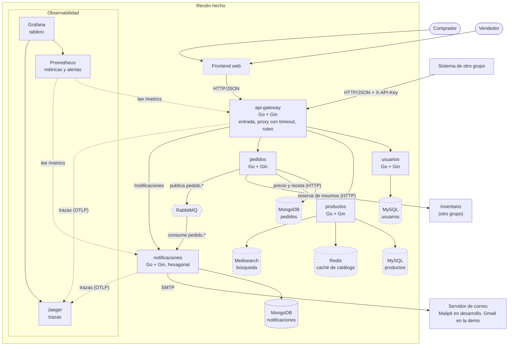
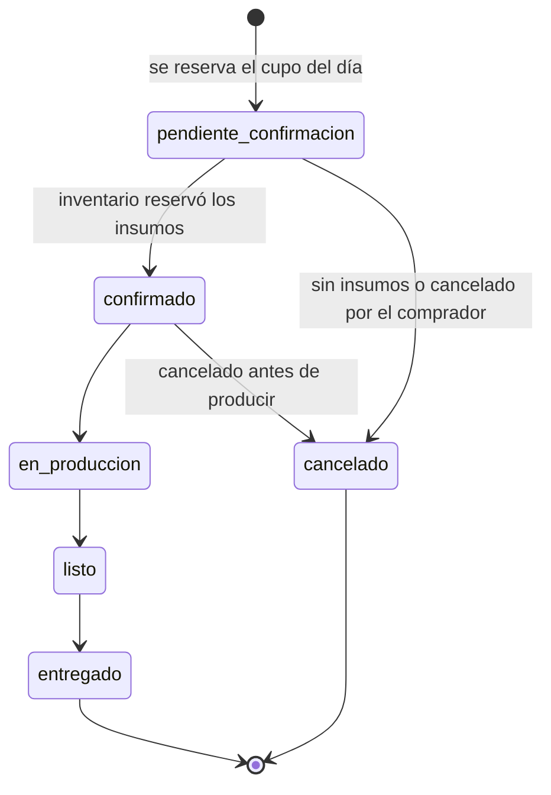

# Arquitectura

Versión de la Entrega 2. Las decisiones que la sostienen están en [docs/adr/](adr/).

## Visión general

Recién hecho es un e-commerce de pastelería a pedido. Los compradores encargan productos para ahora, para una fecha futura o a medida, y la pastelería organiza su producción según la capacidad que tiene cada día.

El backend son cuatro microservicios en Go (Gin) detrás de un api gateway, orquestados con Docker Compose. El sistema publica una capacidad para otro grupo (**notificaciones**) y consume la de otro grupo (**inventario**).

### Diagrama de contexto

### Diagrama de contenedores

Los componentes con borde continuo ya están en el `docker-compose` (Entrega 2). Los de borde punteado están decididos en los ADRs y se suman para la presentación ([ADR-002](adr/ADR-002-persistencia.md), [ADR-003](adr/ADR-003-comunicacion-entre-servicios.md), [ADR-008](adr/ADR-008-busqueda.md), [ADR-009](adr/ADR-009-cache.md)). `usuarios`, `productos` y `pedidos` existen, pero por ahora solo responden `/health`.

Desde afuera solo se entra por el api-gateway (`localhost:8080`). Los servicios no publican puerto, y las herramientas de desarrollo (MongoDB, Mailpit, Jaeger, Prometheus, Grafana) se ven solo desde la propia computadora ([ADR-006](adr/ADR-006-observabilidad.md), [ADR-012](adr/ADR-012-balanceo-de-carga.md)).

## Servicios

Cada servicio es el único dueño de sus datos ([ADR-001](adr/ADR-001-limites-de-los-servicios.md)).

| Servicio | Puerto | Responsabilidad | Datos propios | Expone |
|---|---|---|---|---|
| api-gateway | 8080 | Punto de entrada único, autenticación, ruteo | Ninguno | Todas las rutas públicas |
| usuarios | 8081 | Registro, login, roles comprador/vendedor | Cuentas, roles, contraseñas hasheadas | Registro, login, perfil |
| productos | 8082 | Catálogo, búsqueda, recetario | Productos, precios (centavos), imágenes, recetas | Catálogo, búsqueda, ABM (vendedor) |
| pedidos | 8083 | Pedidos inmediatos, programados y especiales; calendario y capacidad de producción | Pedidos y estados, cupos por día | Crear y seguir pedidos, calendario (vendedor) |
| notificaciones | 8084 | Envío de avisos a compradores y a usuarios de otros grupos | Notificaciones, estados, claves de idempotencia | [Contrato](contracts/notificaciones.yaml) |

La capacidad de producción vive en `pedidos` porque reservar el cupo y crear el pedido tienen que ser una sola operación atómica: es la operación del sistema que no puede duplicar ni perder información.

Cada servicio vive en `backend/<servicio>/`, con su propio `go.mod` y `Dockerfile`, y ningún servicio importa código de otro. `notificaciones` es hexagonal (dominio, aplicación, puertos y adaptadores) y el api-gateway es un proxy sin dominio; la arquitectura interna de cada uno está en [ADR-007](adr/ADR-007-arquitectura-interna.md). `usuarios`, `productos` y `pedidos` por ahora solo responden `/health`. El puerto de la tabla es el interno: desde afuera solo se entra por el api-gateway.

### Estados de un pedido

Los pedidos especiales pasan antes por `solicitado` → `cotizado` y de ahí a `aceptado` (sigue como `pendiente_confirmacion`), `rechazado` o `vencido` (48 h sin respuesta del comprador).

## Datos

| Servicio | Almacenamiento | Motivo |
|---|---|---|
| usuarios | MySQL | Datos tabulares, email único |
| productos | MySQL + Redis | Filtros sobre el catálogo; se lee mucho y cambia poco |
| pedidos | MongoDB | Pedido como documento con sus ítems; campos libres en pedidos especiales |
| notificaciones | MongoDB | Documentos simples, clave de idempotencia única por grupo |

Montos siempre en centavos (`int64`). Detalle y limitaciones en [ADR-002](adr/ADR-002-persistencia.md).

## Comunicación entre servicios

- **Síncrona (HTTP/JSON):** frontend y otros grupos → api-gateway → servicios; `pedidos` → `productos` (precio y receta); `pedidos` → inventario del otro grupo. Con timeouts y reintentos solo en operaciones idempotentes.
- **Asíncrona (RabbitMQ):** `pedidos` publica `pedido.confirmado` y `pedido.estado_cambiado`; `notificaciones` los consume y avisa al comprador.

Valores y reglas en [ADR-003](adr/ADR-003-comunicacion-entre-servicios.md).

## Mensajería y eventos

Exchange `pedidos` (topic), cola `notificaciones.pedidos`, DLQ `notificaciones.fallidos`, consumidor idempotente por `idEvento`. Pendiente para la presentación: hace falta `pedidos`, que publica los eventos.

## Observabilidad

Decisiones en [ADR-006](adr/ADR-006-observabilidad.md) (D11).

- **Logs:** api-gateway y notificaciones escriben una línea JSON por evento en la salida estándar (`docker compose logs`), con `servicio` y, cuando hay una traza activa, `trace_id` y `span_id`. Cada solicitud HTTP deja una línea con `metodo`, `ruta`, `estado` y `duracion_ms`, y cada envío fallido de una notificación, una con `id`, `intento`, `resultado` y `error` (con los emails tapados). No se registran claves de API, claves de idempotencia, destinatarios ni contenidos de mails.
- **Trazas:** OpenTelemetry en api-gateway y notificaciones, exportadas por OTLP a Jaeger (http://localhost:16686). Una solicitud a `POST /notificaciones` por el gateway queda como una sola traza: api-gateway → reenvío HTTP → notificaciones → comandos de MongoDB. Los logs de esa solicitud llevan el mismo `trace_id`. Si Jaeger está caído, los servicios siguen funcionando y solo se pierden las trazas.
- **Métricas:** cada servicio publica `/metrics` en un puerto interno (9464) que no sale del compose; Prometheus lo lee cada 15 s. Las dos tienen `solicitudes_http_total` por método, ruta y estado, y `duracion_solicitud_http_segundos` por método y ruta. El gateway suma `gateway_solicitudes_total` por instancia (reparto del balanceo, ADR-012) y notificaciones suma `notificaciones_envios_total` por resultado (`enviada`, `reintento`, `fallida`), que la aplicación avisa por el puerto `Eventos`: el adaptador `eventos` decide qué contar y qué loguear, así la aplicación no depende de Prometheus ni de `slog`.
- **Alertas** (`observabilidad/prometheus/alertas.yml`): `NotificacionesFallidas` (más de 5 en 10 minutos), `ObjetivoDeLatenciaIncumplido` (menos del 99 % de los `POST /notificaciones` en menos de 300 ms en la última hora) y `ServicioSinMetricas`.
- **Tablero:** Grafana (http://localhost:3000) con Prometheus y Jaeger como fuentes, cargados desde `observabilidad/grafana`: objetivo de latencia, solicitudes por segundo, errores 5xx, alertas disparadas, latencia p95, envíos por resultado y reparto por instancia.
- **Acceso:** en desarrollo, las herramientas de observabilidad se ven solo desde la propia computadora (ADR-006).

## Integraciones externas

| Integración | Rol | Servicio responsable | Estado |
|---|---|---|---|
| Notificaciones | Publicamos | notificaciones (vía api-gateway) | Implementada en local (`localhost:8080`), con el mock del contrato para probar formatos. Falta publicarla en una URL pública ([docs/contracts](contracts/README.md), [ADR-004](adr/ADR-004-contrato-de-notificaciones.md)) |
| Inventario | Consumimos | pedidos | Esperando el contrato del otro grupo (D9) |

## Limitaciones conocidas y deuda técnica

Soluciones más simples que la ideal, elegidas a conciencia. Cada una dice qué impacto tiene, por qué se acepta hoy y cómo se resolvería.

| Limitación | Impacto | Por qué se acepta | Cómo se resuelve |
|---|---|---|---|
| **El límite de 60 solicitudes por minuto se cuenta por instancia.** `notificaciones` lleva el contador en la memoria de cada instancia. | Con dos instancias balanceadas (D12), cada una cuenta por separado y un grupo podría hacer hasta 120 por minuto. Siempre falla para el lado permisivo: nunca se rechaza a un grupo que respetó el límite. Con una sola instancia, el límite se cumple exacto. | El límite protege al servicio de abusos y, con el tráfico esperado, el doble no pone en riesgo nada. Un contador compartido (por ejemplo, en MongoDB) suma una escritura a la base en cada solicitud. | Mover el control de tráfico al api-gateway, que ve todas las solicitudes antes de repartirlas. El enunciado lo pide para la presentación. |
| **Los avisos se entregan "al menos una vez".** Si el servidor de correo acepta un mail pero falla el guardado del estado `enviada`, la notificación se vuelve a tomar cuando vence el apartado (2 minutos) y el mail sale dos veces. | El destinatario puede recibir un mail repetido, solo cuando MongoDB falla justo después de un envío exitoso. | Entre duplicar un aviso y perderlo, es preferible duplicarlo. Garantizar "exactamente una vez" con un servidor SMTP externo no es posible: el servidor no participa de nuestras transacciones. | No hay una solución completa. Se puede reducir la ventana reintentando el guardado del estado antes de soltar la notificación. |
